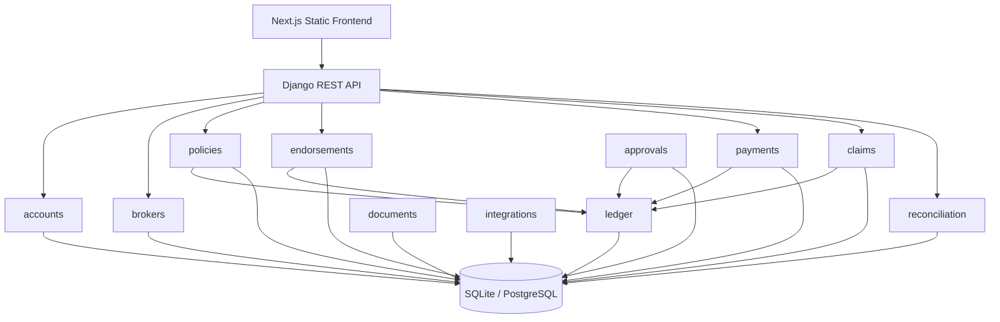

# Architecture

## System Overview

Corgi Track 1 is a policy-administration system for Commercial General Liability (CGL) insurance with two portals (Customer and Staff), a double-entry financial ledger, and provider integrations (Stripe payments, Persona broker KYB).

## Component Diagram



## Dependency Direction

```
Next.js → Django REST API → Domain Services → Django ORM / PostgreSQL
                                    ↓
                          Integration Adapters → Stripe / Persona
```

Business logic lives in service functions within each Django app (e.g., `ledger/services.py`, `policies/services.py`). Views are thin — they validate input via DRF serializers, call services, and return responses.

## Backend Structure

```
backend/
├── manage.py
├── config/           # Django project settings, URLs, WSGI/ASGI
├── apps/
│   ├── accounts/     # Custom User model, roles (CUSTOMER, STAFF)
│   ├── brokers/      # Broker, KYB verification
│   ├── policies/     # Policy, PolicyEvent, TaxRule, FeeRule
│   ├── endorsements/ # Endorsement with state machine
│   ├── ledger/       # LedgerAccount, JournalEntry, JournalLine, services
│   ├── payments/     # Payment, Refund
│   ├── claims/       # Claim, ReserveEvent, ClaimPayment
│   ├── approvals/    # Maker-checker approval workflow
│   ├── reconciliation/ # ReconciliationRun, breaks, BrokerStatement
│   ├── documents/    # Document metadata and generation
│   └── integrations/ # WebhookEvent, provider adapters (Stripe, Persona)
└── tests/            # Root-level smoke tests
```

## Frontend Structure

```
frontend/
├── app/              # Next.js App Router pages
├── components/       # Shared React components
├── lib/              # Utilities, API client
└── tests/            # Frontend tests
```

## Key Design Decisions

- **Append-only ledger**: Posted journal entries and lines are never updated or deleted
- **Integer cents**: All money stored as integer cents (no floats)
- **Calendar anniversary**: Policy terms use same month/day next year, not +365 days
- **Effective vs recorded dates**: Every financial record tracks both when it happened (effective_at) and when the system recorded it (recorded_at)
- **Custom User model**: Defined from project start to avoid migration issues later
