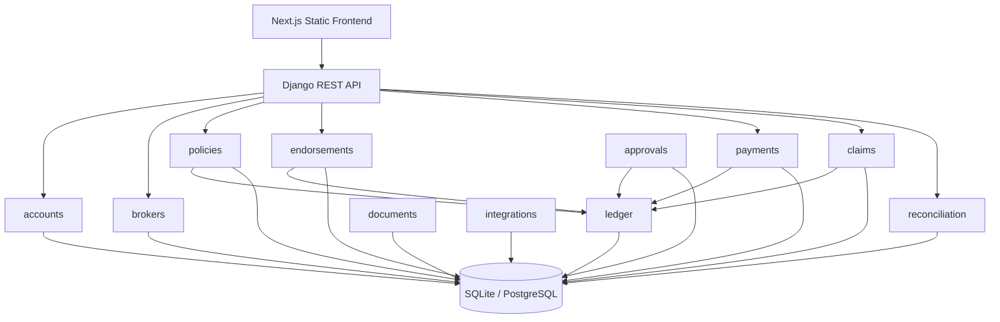

# Architecture

## System Overview

Corgi Track 1 is a policy-administration system for Commercial General Liability (CGL) insurance with two portals (Customer and Staff), a double-entry financial ledger, and provider integrations (Stripe payments, Persona broker KYB).

## Component Diagram



## Dependency Direction

```
Next.js → Django REST API → Domain Services → Django ORM / PostgreSQL
                                    ↓
                          Integration Adapters → Stripe / Persona
```

Business logic lives in service functions within each Django app (e.g., `ledger/services.py`, `policies/services.py`). Views are thin — they validate input via DRF serializers, call services, and return responses.

## Backend Structure

```
backend/
├── manage.py
├── config/           # Django project settings, URLs, WSGI/ASGI
├── apps/
│   ├── accounts/     # Custom User model, roles (CUSTOMER, STAFF)
│   ├── brokers/      # Broker, KYB verification
│   ├── policies/     # Policy, PolicyEvent, TaxRule, FeeRule
│   ├── endorsements/ # Endorsement with state machine
│   ├── ledger/       # LedgerAccount, JournalEntry, JournalLine, services
│   ├── payments/     # Payment, Refund
│   ├── claims/       # Claim, ReserveEvent, ClaimPayment
│   ├── approvals/    # Maker-checker approval workflow
│   ├── reconciliation/ # ReconciliationRun, breaks, BrokerStatement
│   ├── documents/    # Document metadata and generation
│   └── integrations/ # WebhookEvent, provider adapters (Stripe, Persona)
└── tests/            # Root-level smoke tests
```

## Frontend Structure

```
frontend/
├── app/              # Next.js App Router pages
├── components/       # Shared React components
├── lib/              # Utilities, API client
└── tests/            # Frontend tests
```

## Authentication & Authorization

- **Token authentication**: DRF TokenAuthentication for API access from the static Next.js frontend
- **Roles**: STAFF (manage brokers, policies, operations) and CUSTOMER (view own policies)
- **Permission classes**: `IsStaffUser` and `IsCustomerUser` enforce role-based access
- **Seed users**: staff1/staffpass1, staff2/staffpass2 (Staff), customer1/custpass1 (Customer)

## API Endpoints

```
POST /api/auth/login/         → token + user
POST /api/auth/logout/        → revoke token
GET  /api/auth/me/            → current user
POST /api/auth/register/      → create customer

GET  /api/brokers/            → list (Staff only)
POST /api/brokers/            → create broker (Staff only)
GET  /api/brokers/<id>/       → detail (Staff only)
POST /api/brokers/<id>/kyb/   → initiate Persona KYB

GET  /api/policies/           → list (Staff: all, Customer: own)
POST /api/policies/           → create (Staff only, approved broker required)
GET  /api/policies/jurisdictions/ → configured jurisdictions (from tax/fee rules)
GET  /api/policies/<id>/      → detail with events

POST /api/payments/checkout/              → create Stripe Checkout Session
GET  /api/payments/policy/<id>/           → list payments for policy
POST /api/payments/<id>/simulate/         → simulate payment (dev mode only)

GET  /api/policies/<id>/as-of/             → historical policy state (?as_of=datetime)

GET  /api/endorsements/?policy_id=<id>     → list endorsements
POST /api/endorsements/                    → create endorsement (Staff only)
GET  /api/endorsements/<id>/               → endorsement detail
POST /api/endorsements/<id>/approve/       → customer approval
POST /api/endorsements/<id>/apply/         → apply endorsement (Staff only)
POST /api/endorsements/<id>/correct/       → correct endorsement (Staff only)

GET  /api/documents/policy/<id>/declarations/           → declarations PDF (?as_of=)
GET  /api/documents/policy/<id>/endorsement-schedule/   → endorsement schedule PDF (?as_of=)

POST /api/integrations/webhooks/persona/  → Persona webhook (AllowAny, signature-verified)
POST /api/integrations/webhooks/stripe/   → Stripe webhook (AllowAny, signature-verified)
```

## Frontend Routes

| Route | Role | Purpose |
|-------|------|---------|
| `/login` | All | Login form |
| `/staff/brokers` | Staff | Broker list, create, KYB management |
| `/staff/policies` | Staff | Policy list, create with charge breakdown |
| `/staff/payments` | Staff | Payment management, financial details per policy |
| `/customer/policies` | Customer | View own policies, pay button, payment history |
| `/customer/payment-success` | Customer | Stripe checkout success redirect |
| `/customer/payment-cancel` | Customer | Stripe checkout cancel redirect |
| `/staff/policies/detail?id=X` | Staff | Policy detail, endorsements, corrections, as-of, PDFs |
| `/customer/policies/detail?id=X` | Customer | Policy detail, endorsement approval, as-of, PDFs |

## Key Design Decisions

- **Append-only ledger**: Posted journal entries and lines are never updated or deleted
- **Integer cents**: All money stored as integer cents (no floats)
- **Calendar anniversary**: Policy terms use same month/day next year, not +365 days
- **Effective vs recorded dates**: Every financial record tracks both when it happened (effective_at) and when the system recorded it (recorded_at)
- **Custom User model**: Defined from project start to avoid migration issues later
- **Persona adapter boundary**: `integrations/persona/` module with graceful degradation (SIMULATED prefix when no credentials)
- **Webhook idempotency**: WebhookEvent with unique idempotency_key prevents duplicate processing
- **Out-of-order tolerance**: KYB state never regresses from APPROVED/REJECTED regardless of webhook arrival order
- **Texas surplus-lines tax model**: TX Surplus Lines Premium Tax (4.85%), SLTX Stamping Fee (0.04%) — both refundable, effective-dated rules
- **Stripe Checkout flow**: DRAFT → create Checkout Session → PENDING_PAYMENT → webhook confirms → post ledger → ACTIVE
- **Stripe adapter boundary**: `integrations/stripe/` module with SIMULATED mode when no credentials
- **Commission on collected premium**: Broker commission posted at payment time, earned on premium only
- **Pro-rata endorsements**: `(annual_delta * remaining_days) / total_days_in_term` using Decimal with ROUND_HALF_UP
- **Endorsement threshold**: > $500 total requires customer approval before collection
- **Correction = reversal + re-book**: Original entries reversed, corrected endorsement created, no mutation of posted entries
- **As-of reconstruction**: Reconstructs policy state at any historical point from base premium + applied endorsements filtered by recorded_at
- **PDF generation**: reportlab for declarations pages and endorsement schedules, supports as-of parameter
