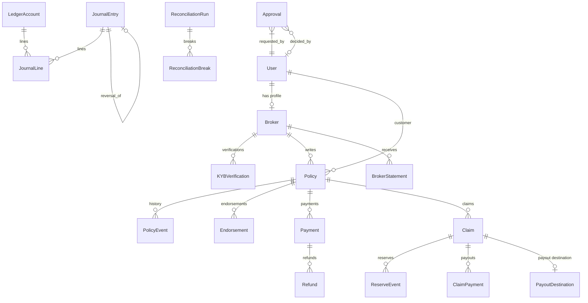

# Domain Model

## Entity Relationship Diagram

## Core Entities

### User
Custom Django User with role field: `CUSTOMER` or `STAFF`.

### Broker
Insurance broker with KYB verification status. Must be APPROVED before binding business.
- `status`: PENDING_KYB → APPROVED | REJECTED
- `commission_rate_bps`: Commission rate in basis points

### Policy
CGL insurance policy with calendar-anniversary terms.
- `policy_number`: Unique identifier
- `status`: DRAFT → PENDING_PAYMENT → ACTIVE → CANCELLED | EXPIRED
- `effective_date` / `expiration_date`: Term boundaries
- `premium_amount_cents`: Base premium in integer cents
- `coverage_territory`: US state code

### PolicyEvent
Append-only history of policy state changes with separate `effective_at` and `recorded_at` timestamps.

### Endorsement
Mid-term policy modification with pro-rata pricing.
- `endorsement_type`: COVERAGE_LIMIT_CHANGE | ADDRESS_CORRECTION
- `status`: PENDING_CUSTOMER_APPROVAL | PENDING_PAYMENT | APPROVED → APPLIED | REVERSED
- `annual_premium_delta_cents`: Annual premium change before pro-rating
- `premium_change_cents`: Pro-rated amount for remaining term (signed integer)
- `charges_snapshot`: JSON snapshot of computed charges (premium, tax, fees)
- `correction_of`: FK to original endorsement (for corrections)
- **Threshold**: > $500 total requires customer approval
- **Pro-rata**: `(annual_delta × remaining_days) / total_days` using Decimal ROUND_HALF_UP

### Payment
Payment tracks Stripe payment intents with full charge breakdown.

### Refund
Refund tracks Stripe refunds linked to a payment.
- `status`: PENDING → SUCCEEDED | FAILED
- `stripe_refund_id`: Provider reference (SIMULATED-rf-xxx when no Stripe key)
- `charges_snapshot`: JSON with cancellation breakdown (unearned premium, refundable tax/fees, clawback)
- `reason`: Human-readable reason (e.g., "Pro-rata cancellation as of 2025-07-01")
- Ledger entries posted only on SUCCEEDED (not at creation)
- Refund entry: DR 2000/2100/2150 / CR 2400 (reverse unearned liabilities into refund payable)
- Clawback entry: DR 2200 / CR 4200 (separate journal entry)

### BrokerStatement
Monthly broker commission statement derived from Payment/Refund records.
- `total_premium_cents`: Sum of premium collected in period
- `total_commission_cents`: Commission earned on collected premium
- `total_clawback_cents`: Commission clawed back from cancellation refunds
- `net_due_cents`: `commission - clawback`
- `statement_data`: JSON with payment/refund line items
- `is_closed`: Whether statement has been finalized
- **Reproducible**: `unique_together` on (broker, period_start, period_end) — same period returns same result

### Policy (M5 additions)
- `coverage_limit_cents`: Per-occurrence limit in integer cents (default $1M)

### Claim
Customer-submitted insurance claim.
- `claim_number`: Sequential CLM-XXXXXX
- `status`: OPEN → UNDER_REVIEW → RESERVED → PAYMENT_PENDING → PARTIALLY_PAID → PAID → CLOSED
- `date_of_loss`: Must be within policy coverage dates
- `estimated_amount_cents`: Customer-provided estimate (optional)
- Claims remain valid after policy cancellation if incident was during coverage

### ReserveEvent
Append-only reserve adjustments. Never mutated after creation.
- `amount_cents`: Signed integer (positive = increase, negative = decrease)
- `reserve_type`: INITIAL | ADJUSTMENT | RELEASE
- Each event posts balanced journal entries (DR 5000 / CR 2300 or reversed)
- **Identity**: Incurred = Paid + Remaining Reserve

### ClaimPayment
Claim payment with maker-checker approval workflow.
- `status`: DRAFT → PENDING_APPROVAL → APPROVED → PENDING → SETTLED | RETURNED | FAILED
- `approved_by`: Must differ from `created_by` (maker-checker invariant)
- `payout_reference`: SIM-PAY-xxx reference from payout simulator
- **Threshold**: >= $5,000 requires second staff approval

### PayoutDestination
Bank account verification for claim payouts.
- `verification_status`: PENDING → VERIFIED | FAILED
- `provider`: "SIMULATED" in v1, adapter for future Plaid replacement
- `provider_reference`: SIM-BANK-xxx reference
- Payout blocked unless verification_status = VERIFIED

### ReconciliationRun
Represents a single reconciliation comparison between local records and provider truth.
- `run_date`: Date of reconciliation
- `status`: RUNNING → COMPLETED | FAILED
- `summary`: JSON with break count and error info

### ReconciliationBreak
A discrepancy detected between local and provider records.
- `break_type`: MISSING_IN_LEDGER | MISSING_IN_PROVIDER | AMOUNT_MISMATCH | STATUS_MISMATCH | DUPLICATE_MATCH | STALE_UNRESOLVED
- `status`: OPEN → ACKNOWLEDGED → RESOLVED
- `source`: Provider source (e.g., "STRIPE")
- `external_reference`: Provider-side identifier (e.g., pi_xxx)
- `local_reference`: Local record ID
- `expected_amount_cents` / `actual_amount_cents`: Amounts for mismatch comparison
- `first_seen_at`: When the break was first detected
- `resolution_notes`: Staff notes on resolution
- `resolved_by`: Staff user who resolved the break

### LedgerAccount / JournalEntry / JournalLine
Double-entry append-only ledger. See [MONEY_FLOWS.md](MONEY_FLOWS.md).

### TaxRule / FeeRule
Effective-dated tax and fee rules per jurisdiction. Historical rules preserved for accurate reconstruction.

**Implemented: Texas surplus-lines model**

| Component | Model | Type | Rate | Refundable | Effective |
|-----------|-------|------|------|------------|-----------|
| TX Surplus Lines Premium Tax | TaxRule | TAX | 485 bps (4.85%) | Yes | 2024-01-01 |
| TX SLTX Stamping Fee | FeeRule | RATE | 4 bps (0.04%) | Yes | 2024-01-01 |

Rate arithmetic uses `Decimal` with `ROUND_HALF_UP` via `calculate_rate_amount(amount_cents, rate_bps)`. No Python `float` in financial calculations.

### Approval
Generic maker-checker approval using Django's ContentType framework.

### WebhookEvent
Idempotent webhook event log for Stripe and Persona.

## Money Representation

All money is stored as **integer cents** (PositiveIntegerField or IntegerField). No floating-point arithmetic for financial calculations.

| Amount | Stored Value |
|--------|-------------|
| $1.00  | 100         |
| $10.50 | 1050        |
| $1,200.00 | 120000   |

## Temporal Model

Financial and policy records maintain two time dimensions:
- **effective_at**: When the business event applies (the "as of" date)
- **recorded_at**: When the system recorded the event (auto-set on creation)

This enables backdated endorsements and historical policy reconstruction.
