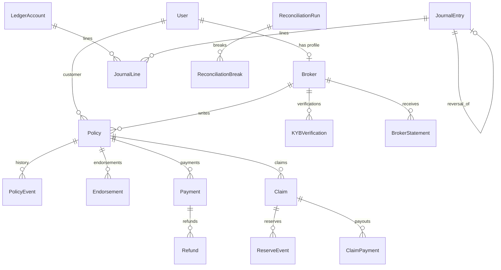

# Domain Model

## Entity Relationship Diagram

## Core Entities

### User
Custom Django User with role field: `CUSTOMER` or `STAFF`.

### Broker
Insurance broker with KYB verification status. Must be APPROVED before binding business.
- `status`: PENDING_KYB → APPROVED | REJECTED
- `commission_rate_bps`: Commission rate in basis points

### Policy
CGL insurance policy with calendar-anniversary terms.
- `policy_number`: Unique identifier
- `status`: DRAFT → PENDING_PAYMENT → ACTIVE → CANCELLED | EXPIRED
- `effective_date` / `expiration_date`: Term boundaries
- `premium_amount_cents`: Base premium in integer cents
- `coverage_territory`: US state code

### PolicyEvent
Append-only history of policy state changes with separate `effective_at` and `recorded_at` timestamps.

### Endorsement
Mid-term policy modification.
- `status`: DRAFT → PENDING_CUSTOMER_APPROVAL → APPROVED → PENDING_PAYMENT → APPLIED | REVERSED
- `premium_change_cents`: Signed integer (positive = additional premium)

### Payment / Refund
Payment tracks Stripe payment intents. Refund tracks Stripe refunds linked to a payment.

### Claim / ReserveEvent / ClaimPayment
Claims with append-only reserve events and maker-checker claim payments.

### LedgerAccount / JournalEntry / JournalLine
Double-entry append-only ledger. See [MONEY_FLOWS.md](MONEY_FLOWS.md).

### TaxRule / FeeRule
Effective-dated tax and fee rules per jurisdiction. Historical rules preserved for accurate reconstruction.

### Approval
Generic maker-checker approval using Django's ContentType framework.

### WebhookEvent
Idempotent webhook event log for Stripe and Persona.

## Money Representation

All money is stored as **integer cents** (PositiveIntegerField or IntegerField). No floating-point arithmetic for financial calculations.

| Amount | Stored Value |
|--------|-------------|
| $1.00  | 100         |
| $10.50 | 1050        |
| $1,200.00 | 120000   |

## Temporal Model

Financial and policy records maintain two time dimensions:
- **effective_at**: When the business event applies (the "as of" date)
- **recorded_at**: When the system recorded the event (auto-set on creation)

This enables backdated endorsements and historical policy reconstruction.
