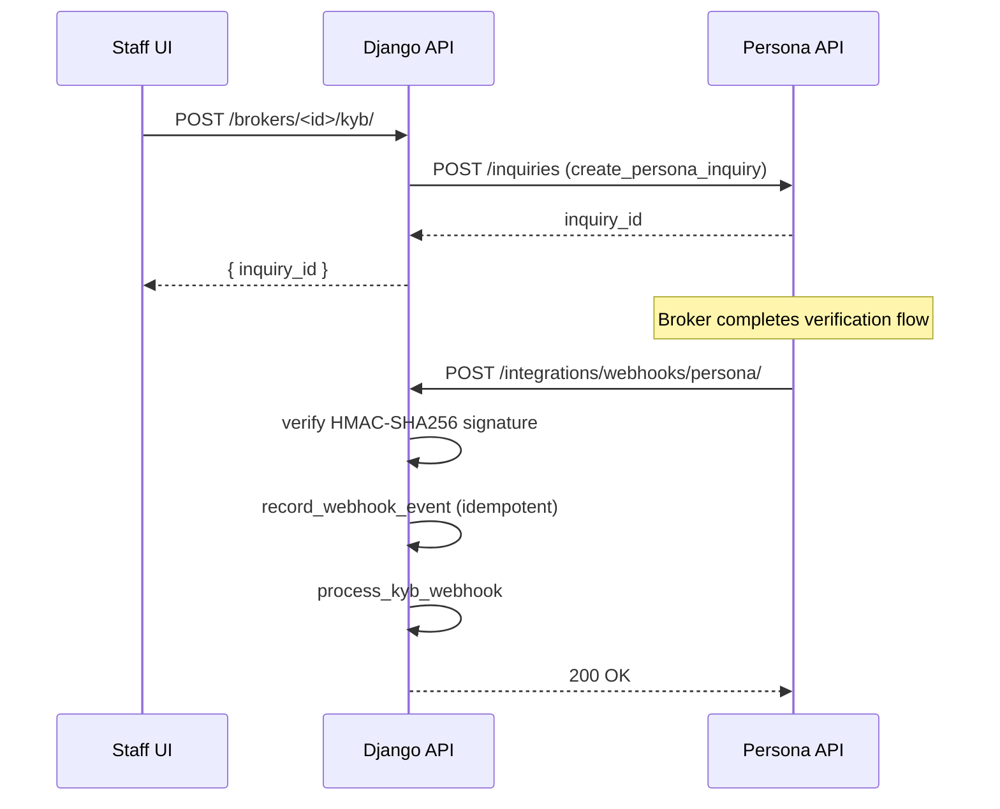
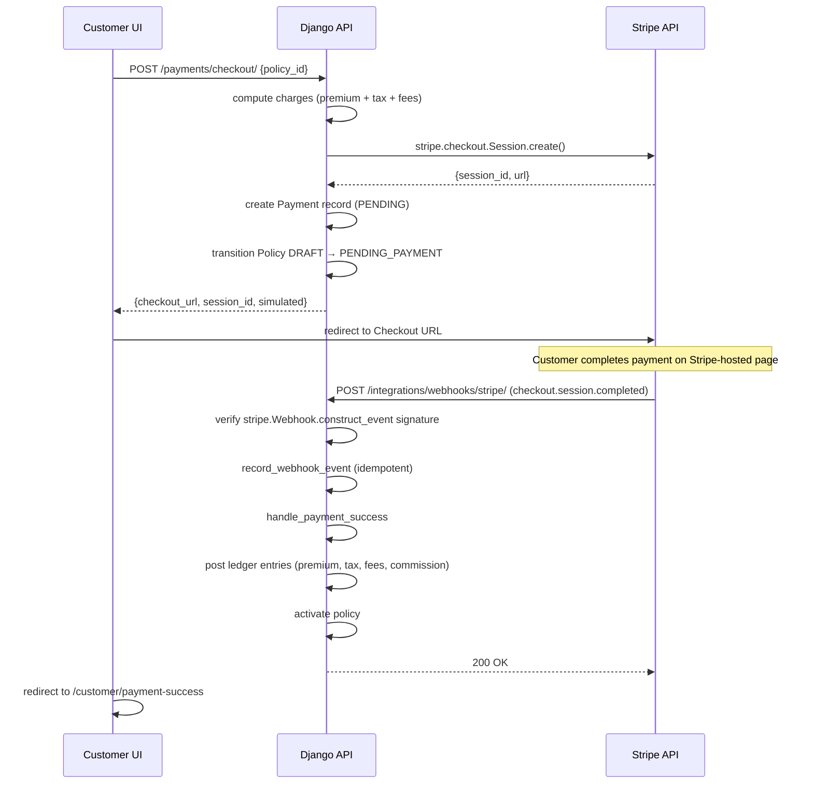

# Integrations

## Persona (Broker KYB)

### Flow

### Webhook Security

- **Signature verification**: HMAC-SHA256 using `PERSONA_WEBHOOK_SECRET`
- **Format**: `Persona-Signature: t=<timestamp>,v1=<hex_signature>`
- **Signed payload**: `{timestamp}.{request_body}`
- **No auth required**: Endpoint uses `AllowAny` permission, CSRF exempt

### Idempotency

- Each webhook event has a unique `event_id` from Persona
- `WebhookEvent.idempotency_key` = `PERSONA-{event_id}` (unique constraint)
- Duplicate delivery returns 200 with `"Already processed"` — no re-processing

### Out-of-Order Tolerance

- Once a broker reaches `APPROVED` or `REJECTED`, the state never regresses
- Late-arriving events for already-finalized brokers are silently accepted

### Simulated Mode

When `PERSONA_API_KEY` or `PERSONA_TEMPLATE_ID` is not configured:
- `create_persona_inquiry()` returns `SIMULATED-{uuid}` instead of calling the real API
- The SIMULATED prefix is displayed in the UI as a warning
- Webhook processing works identically — simulated brokers follow the same state machine

### Environment Variables

| Variable | Purpose |
|----------|---------|
| `PERSONA_API_KEY` | Persona API key (sandbox or production) |
| `PERSONA_WEBHOOK_SECRET` | HMAC secret for verifying webhook signatures |
| `PERSONA_TEMPLATE_ID` | Persona inquiry template ID |
| `PERSONA_API_BASE` | API base URL (default: `https://withpersona.com/api/v1`) |

## Stripe (Premium Collection)

### Flow

### Webhook Security

- **Signature verification**: `stripe.Webhook.construct_event()` using `STRIPE_WEBHOOK_SECRET`
- **No auth required**: Endpoint uses `AllowAny` permission, CSRF exempt
- **Dev mode**: When `STRIPE_WEBHOOK_SECRET` is not configured, signature verification is bypassed (returns True)

### Idempotency

- Each webhook event has a unique `id` field from Stripe (e.g., `evt_...`)
- `WebhookEvent.idempotency_key` = `STRIPE-{event_id}` (unique constraint)
- Duplicate delivery returns 200 — no re-processing
- Payment-level idempotency: `handle_payment_success` returns early if payment already SUCCEEDED
- Ledger-level idempotency: journal entries use `idempotency_key` = `premium-collection-{payment_id}` and `commission-{payment_id}`

### Handled Webhook Events

| Stripe Event | Action |
|-------------|--------|
| `checkout.session.completed` | Find Payment by session_id, post ledger, activate policy |
| `checkout.session.expired` | Mark Payment as FAILED, policy stays PENDING_PAYMENT for retry |

### Simulated Mode

When `STRIPE_SECRET_KEY` is not configured:
- `create_checkout_session()` returns `SIMULATED-cs-{uuid}` session ID and `#simulated` checkout URL
- The SIMULATED prefix is displayed in the UI as a warning label
- A dedicated `/payments/<id>/simulate/` endpoint completes payment without Stripe
- Simulated payments follow the same ledger posting and policy activation flow

### Environment Variables

| Variable | Purpose |
|----------|---------|
| `STRIPE_SECRET_KEY` | Stripe API secret key (test or live mode) |
| `STRIPE_PUBLISHABLE_KEY` | Stripe publishable key (passed to frontend) |
| `STRIPE_WEBHOOK_SECRET` | Webhook endpoint signing secret |
| `FRONTEND_URL` | Base URL for Checkout success/cancel redirects (default: `http://localhost:3000`) |

## Webhook Event Model

All provider webhooks are logged in the `WebhookEvent` model:

| Field | Description |
|-------|-------------|
| `provider` | PERSONA or STRIPE |
| `event_id` | Provider's event identifier |
| `event_type` | Event name (e.g., `inquiry.completed`) |
| `payload` | Full JSON payload |
| `status` | RECEIVED → PROCESSED or FAILED |
| `idempotency_key` | `{provider}-{event_id}` (unique) |
| `processed_at` | Timestamp when processing completed |
| `error_message` | Error details if processing failed |
