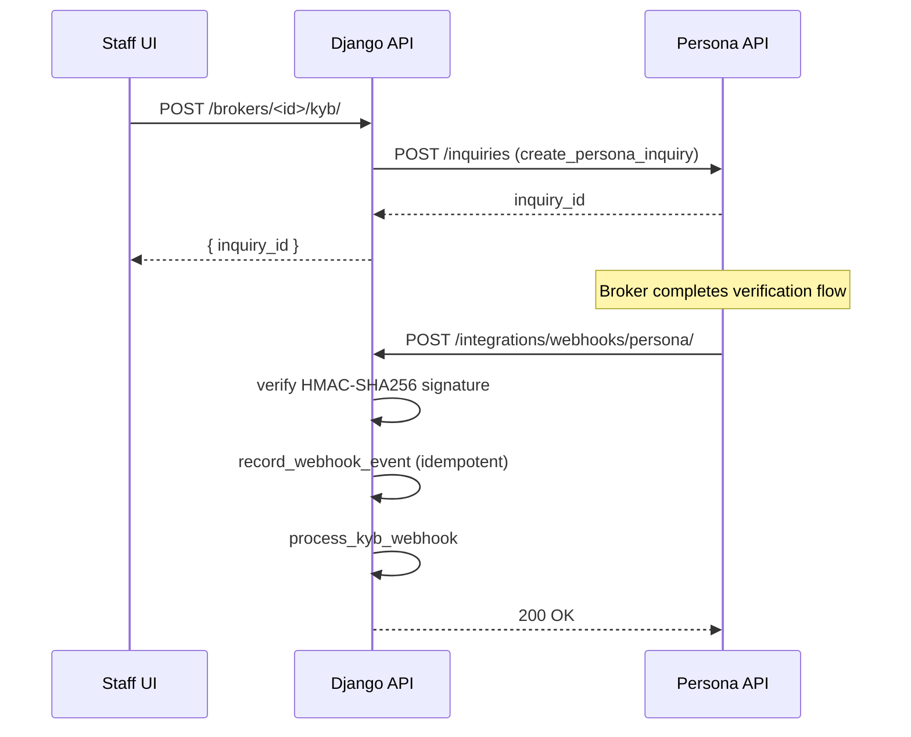

# Integrations

## Persona (Broker KYB)

### Flow

### Webhook Security

- **Signature verification**: HMAC-SHA256 using `PERSONA_WEBHOOK_SECRET`
- **Format**: `Persona-Signature: t=<timestamp>,v1=<hex_signature>`
- **Signed payload**: `{timestamp}.{request_body}`
- **No auth required**: Endpoint uses `AllowAny` permission, CSRF exempt

### Idempotency

- Each webhook event has a unique `event_id` from Persona
- `WebhookEvent.idempotency_key` = `PERSONA-{event_id}` (unique constraint)
- Duplicate delivery returns 200 with `"Already processed"` — no re-processing

### Out-of-Order Tolerance

- Once a broker reaches `APPROVED` or `REJECTED`, the state never regresses
- Late-arriving events for already-finalized brokers are silently accepted

### Simulated Mode

When `PERSONA_API_KEY` or `PERSONA_TEMPLATE_ID` is not configured:
- `create_persona_inquiry()` returns `SIMULATED-{uuid}` instead of calling the real API
- The SIMULATED prefix is displayed in the UI as a warning
- Webhook processing works identically — simulated brokers follow the same state machine

### Environment Variables

| Variable | Purpose |
|----------|---------|
| `PERSONA_API_KEY` | Persona API key (sandbox or production) |
| `PERSONA_WEBHOOK_SECRET` | HMAC secret for verifying webhook signatures |
| `PERSONA_TEMPLATE_ID` | Persona inquiry template ID |
| `PERSONA_API_BASE` | API base URL (default: `https://withpersona.com/api/v1`) |

## Stripe (Premium Collection)

Not yet implemented. Will be added in Milestone 3.

## Webhook Event Model

All provider webhooks are logged in the `WebhookEvent` model:

| Field | Description |
|-------|-------------|
| `provider` | PERSONA or STRIPE |
| `event_id` | Provider's event identifier |
| `event_type` | Event name (e.g., `inquiry.completed`) |
| `payload` | Full JSON payload |
| `status` | RECEIVED → PROCESSED or FAILED |
| `idempotency_key` | `{provider}-{event_id}` (unique) |
| `processed_at` | Timestamp when processing completed |
| `error_message` | Error details if processing failed |
