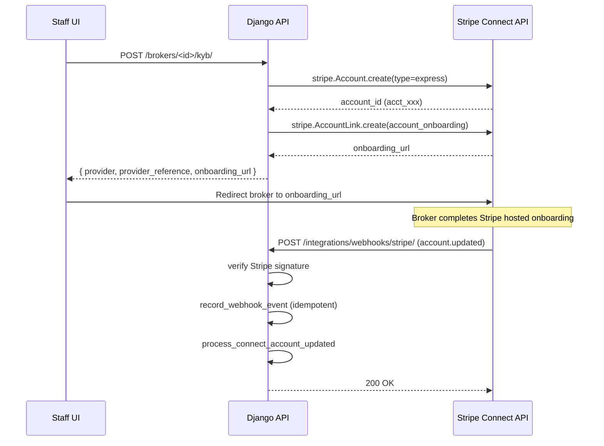
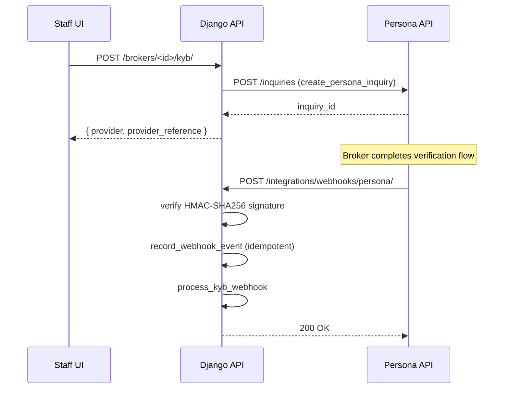
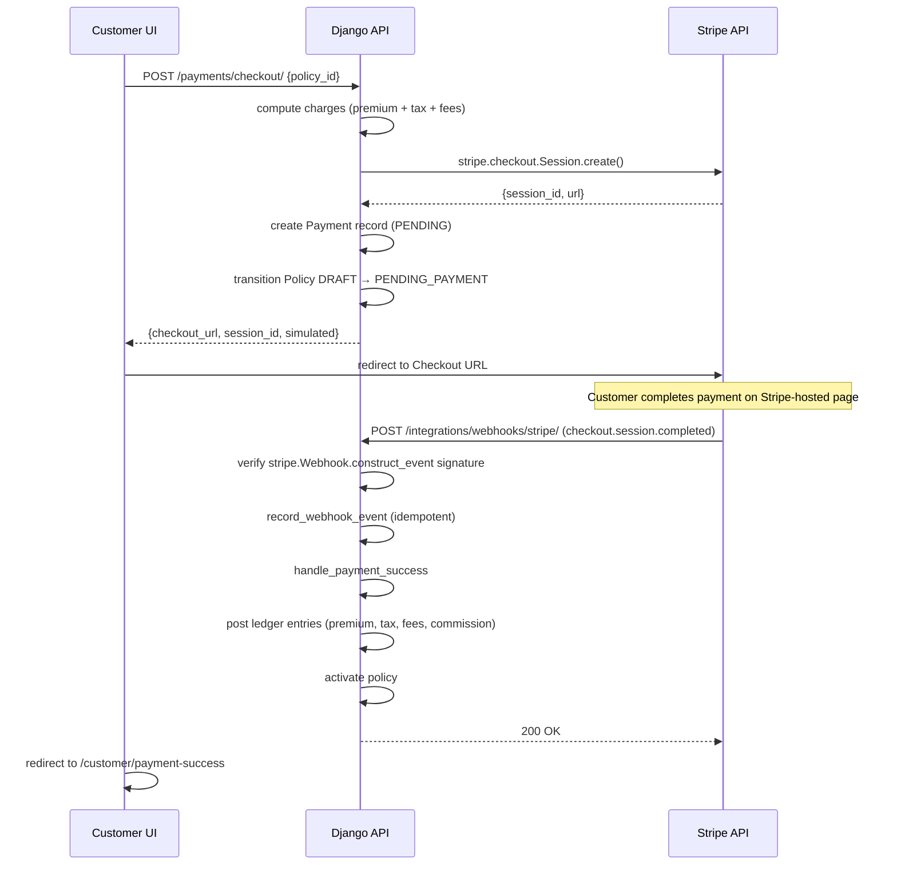
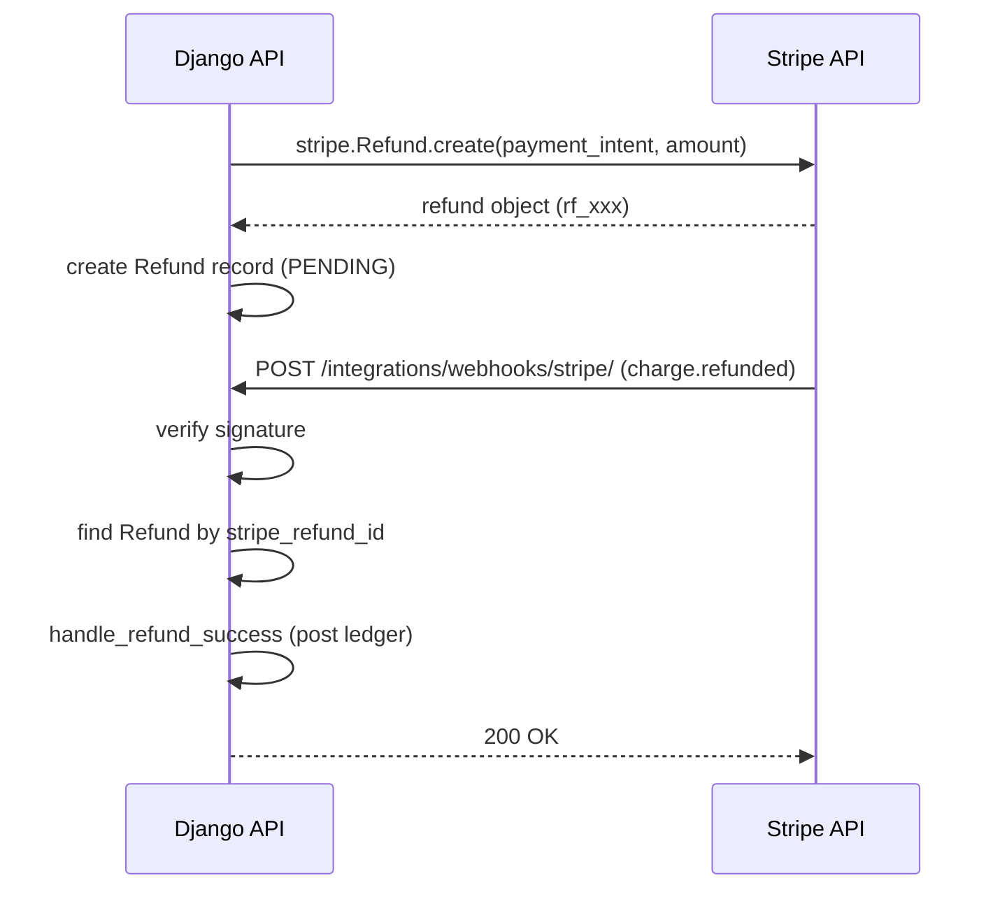
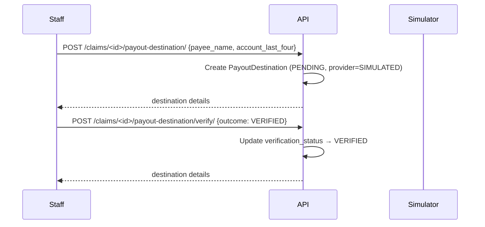
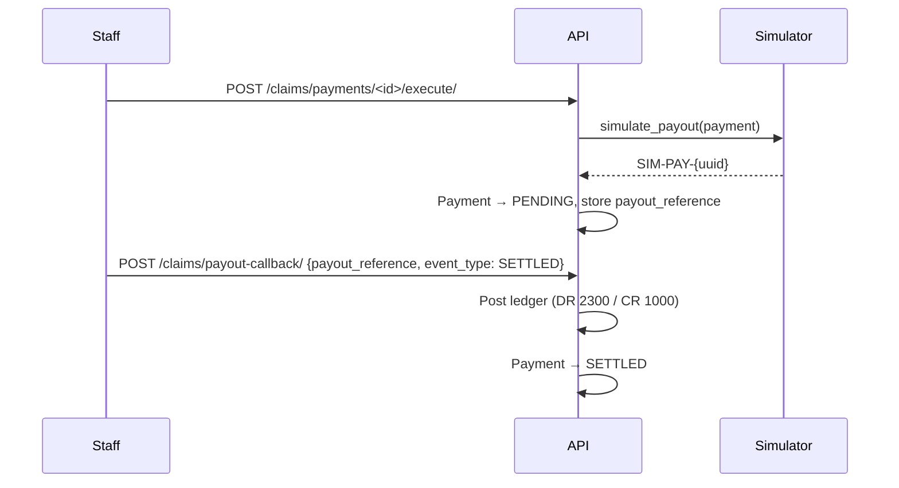
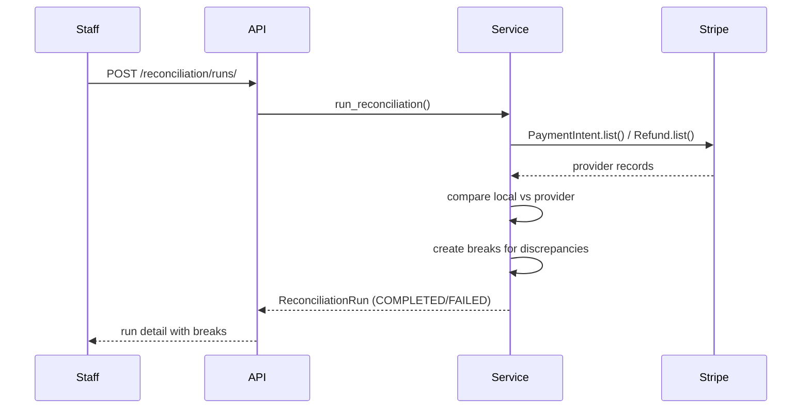

# Integrations

## KYB Provider Configuration

Broker KYB (Know Your Business) verification supports multiple providers. The active provider is configured in Django Admin under **Integrations > KYB Provider Configuration**.

| Provider | Description |
|----------|-------------|
| **Stripe Connect** (default) | Creates Express connected accounts; brokers complete Stripe's hosted onboarding; `account.updated` webhooks drive state transitions |
| **Persona** | Creates Persona inquiries; brokers complete Persona's verification flow; Persona webhooks drive state transitions |
| **Simulated** | No real provider; generates `SIMULATED-` references; state must be advanced manually |

The broker state machine is the same regardless of provider: `PENDING_KYB` → `APPROVED` | `REJECTED`.

## Stripe Connect (Broker KYB — Default)

### Flow

### Verification Logic

The broker is considered **verified** when the Stripe Connect account meets ALL of:
- `charges_enabled == True`
- `requirements.currently_due` is empty

The broker is **rejected** when:
- `requirements.disabled_reason` starts with `"rejected"` (e.g., `"rejected.fraud"`)

### Webhook Events

| Stripe Event | Action |
|-------------|--------|
| `account.updated` | Check `charges_enabled` + `requirements`; approve or reject broker |

### Idempotency & Out-of-Order Tolerance

- Same `WebhookEvent` idempotency model as payment webhooks
- Once a broker reaches `APPROVED` or `REJECTED`, the state never regresses
- Late-arriving `account.updated` events for finalized brokers are silently accepted

### Simulated Mode

When `STRIPE_SECRET_KEY` is not configured:
- `create_connect_account()` returns `SIMULATED-acct-{uuid}` instead of calling the real API
- No onboarding URL is generated
- The SIMULATED prefix is displayed in the UI as a warning

## Persona (Broker KYB — Alternative)

### Flow

### Webhook Security

- **Signature verification**: HMAC-SHA256 using `PERSONA_WEBHOOK_SECRET`
- **Format**: `Persona-Signature: t=<timestamp>,v1=<hex_signature>`
- **Signed payload**: `{timestamp}.{request_body}`
- **No auth required**: Endpoint uses `AllowAny` permission, CSRF exempt

### Idempotency

- Each webhook event has a unique `event_id` from Persona
- `WebhookEvent.idempotency_key` = `PERSONA-{event_id}` (unique constraint)
- Duplicate delivery returns 200 with `"Already processed"` — no re-processing

### Out-of-Order Tolerance

- Once a broker reaches `APPROVED` or `REJECTED`, the state never regresses
- Late-arriving events for already-finalized brokers are silently accepted

### Simulated Mode

When `PERSONA_API_KEY` or `PERSONA_TEMPLATE_ID` is not configured:
- `create_persona_inquiry()` returns `SIMULATED-{uuid}` instead of calling the real API
- The SIMULATED prefix is displayed in the UI as a warning
- Webhook processing works identically — simulated brokers follow the same state machine

### Environment Variables

| Variable | Purpose |
|----------|---------|
| `PERSONA_API_KEY` | Persona API key (sandbox or production) |
| `PERSONA_WEBHOOK_SECRET` | HMAC secret for verifying webhook signatures |
| `PERSONA_TEMPLATE_ID` | Persona inquiry template ID |
| `PERSONA_API_BASE` | API base URL (default: `https://withpersona.com/api/v1`) |

## Stripe (Premium Collection)

### Flow

### Webhook Security

- **Signature verification**: `stripe.Webhook.construct_event()` using `STRIPE_WEBHOOK_SECRET`
- **No auth required**: Endpoint uses `AllowAny` permission, CSRF exempt
- **Dev mode**: When `STRIPE_WEBHOOK_SECRET` is not configured, signature verification is bypassed (returns True)

### Idempotency

- Each webhook event has a unique `id` field from Stripe (e.g., `evt_...`)
- `WebhookEvent.idempotency_key` = `STRIPE-{event_id}` (unique constraint)
- Duplicate delivery returns 200 — no re-processing
- Payment-level idempotency: `handle_payment_success` returns early if payment already SUCCEEDED
- Ledger-level idempotency: journal entries use `idempotency_key` = `premium-collection-{payment_id}` and `commission-{payment_id}`

### Handled Webhook Events

| Stripe Event | Action |
|-------------|--------|
| `checkout.session.completed` | Find Payment by session_id, post ledger, activate policy |
| `checkout.session.expired` | Mark Payment as FAILED, policy stays PENDING_PAYMENT for retry |
| `charge.refunded` | Find Refund by stripe_refund_id, post refund + clawback ledger entries |
| `account.updated` | Check Connect account verification status, approve/reject broker |

### Stripe Refund Flow (Cancellation)

### Simulated Mode

When `STRIPE_SECRET_KEY` is not configured:
- `create_checkout_session()` returns `SIMULATED-cs-{uuid}` session ID and `#simulated` checkout URL
- `create_stripe_refund()` returns `SIMULATED-rf-{uuid}` refund ID
- The SIMULATED prefix is displayed in the UI as a warning label
- A dedicated `/payments/<id>/simulate/` endpoint completes payment without Stripe
- A dedicated `/payments/refunds/<id>/simulate/` endpoint completes refund without Stripe
- Simulated payments and refunds follow the same ledger posting flows

### Environment Variables

| Variable | Purpose |
|----------|---------|
| `STRIPE_SECRET_KEY` | Stripe API secret key (test or live mode) |
| `STRIPE_PUBLISHABLE_KEY` | Stripe publishable key (passed to frontend) |
| `STRIPE_WEBHOOK_SECRET` | Webhook endpoint signing secret |
| `FRONTEND_URL` | Base URL for Checkout success/cancel redirects (default: `http://localhost:3000`) |

## Bank Verification Simulator (Claim Payouts)

### Purpose

Before a claim payout can execute, the claimant's payout destination must be verified. In v1, this is **SIMULATED** — no real bank account verification occurs.

### Model

`PayoutDestination` stores the verification state for a claim's payout account:
- `verification_status`: PENDING → VERIFIED | FAILED
- `provider`: Always "SIMULATED" in v1
- `provider_reference`: Auto-generated `SIM-BANK-{uuid}` reference

### Flow

### Adapter Pattern

The simulator is behind `apps/claims/simulators.py`. A future Plaid/Auth+Identity implementation replaces the simulator functions while the service layer remains unchanged.

## Payout Simulator (Claim Payments)

### Purpose

Claim payout execution is **SIMULATED** in v1. The simulator generates a reference and the payout lifecycle is managed via callback endpoints.

### Flow

### Supported Events

| Event | Action |
|-------|--------|
| SETTLED | Post ledger entries, mark payment SETTLED |
| RETURNED | Post compensating ledger entries, mark payment RETURNED |

### Idempotency

- Duplicate SETTLED event on an already-SETTLED payment is a no-op (returns existing payment)
- Duplicate RETURNED event on an already-RETURNED payment is a no-op
- Ledger entries use idempotency keys: `payout-settled-{reference}`, `payout-returned-{reference}`

## Stripe Idempotency Keys (Outbound)

Outbound Stripe API calls include idempotency keys to prevent duplicate charges or refunds:

| API Call | Idempotency Key |
|----------|----------------|
| `create_checkout_session` | `metadata.idempotency_key` (passed to Stripe session metadata) |
| `create_stripe_refund` | `cancel-refund-{policy_id}` (via metadata + Stripe idempotency_key param) |

Stripe returns the same response for duplicate requests with the same idempotency key within 24 hours.

## Reconciliation Service

### Purpose

Compares local Payment/Refund records against provider truth (Stripe API or SIMULATED local records). Detects discrepancies and creates break records for staff investigation.

### Flow

### Break Types

| Type | Meaning |
|------|---------|
| MISSING_IN_LEDGER | Provider has a record we don't |
| MISSING_IN_PROVIDER | We have a record the provider doesn't |
| AMOUNT_MISMATCH | Amounts differ between local and provider |
| STATUS_MISMATCH | Status differs between local and provider |
| DUPLICATE_MATCH | Potential duplicate record detected |
| STALE_UNRESOLVED | Break has been open longer than threshold |

### SIMULATED Mode

When `STRIPE_SECRET_KEY` is not configured, the reconciliation service uses local records as "provider truth." SIMULATED-prefixed records are skipped for provider comparison since they were never sent to the real provider.

## MCP Server

### Purpose

Provides an MCP (Model Context Protocol) interface for AI agent interaction with the policy administration system. Implemented with FastMCP.

### Tools

| Tool | Type | Purpose |
|------|------|---------|
| `read_policy` | Read | Policy details, events, endorsements |
| `read_claim` | Read | Claim details, reserves, payments, financials |
| `read_reconciliation_breaks` | Read | Break listing with status filtering |
| `create_action_request` | Write | Creates approval request (enters human queue) |

### Safety Invariants

- Agent-created requests enter PENDING status (never auto-approved)
- Reason tagged with `[MCP Agent]` for audit trail
- No tool exposes ledger mutation
- Maker-checker enforced — requesting user cannot approve their own request
- Valid action types: CLAIM_PAYMENT, REFUND, PAYOUT
- Valid target types: claim_payment, refund

## Redis (WebSocket Channel Layer)

### Purpose

Redis serves as the channel layer backend for Django Channels, enabling WebSocket-based real-time event delivery from backend service functions to connected frontend clients.

### Architecture

- **Backend**: Django Channels with `channels_redis.core.RedisChannelLayer`
- **Server**: Daphne ASGI server (serves both HTTP and WebSocket on port 8000)
- **Frontend**: WebSocketProvider context + `useRealtimeRefresh` hook
- **AWS**: ElastiCache Redis (`cache.t4g.micro`, single node, private subnets)

### Environment Variables

| Variable | Purpose |
|----------|---------|
| `REDIS_URL` | Redis connection URL (default: `redis://localhost:6379/0`) |

### Docker Compose

Redis is provided via `redis:7-alpine` with health check. Backend depends on Redis being healthy before starting.

### Graceful Degradation

If Redis is unavailable:
- WebSocket connections will fail (clients auto-reconnect every 3s)
- Service functions continue to work normally — notification calls are wrapped in try/except
- REST API remains fully functional (Daphne serves HTTP independently of the channel layer)

## Webhook Event Model

All provider webhooks are logged in the `WebhookEvent` model:

| Field | Description |
|-------|-------------|
| `provider` | PERSONA or STRIPE |
| `event_id` | Provider's event identifier |
| `event_type` | Event name (e.g., `inquiry.completed`) |
| `payload` | Full JSON payload |
| `status` | RECEIVED → PROCESSED or FAILED |
| `idempotency_key` | `{provider}-{event_id}` (unique) |
| `processed_at` | Timestamp when processing completed |
| `error_message` | Error details if processing failed |
