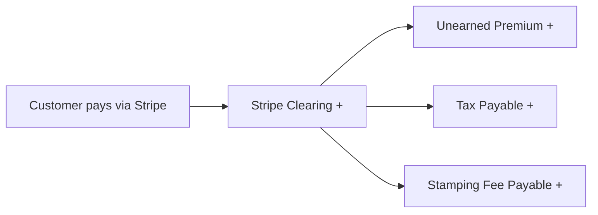
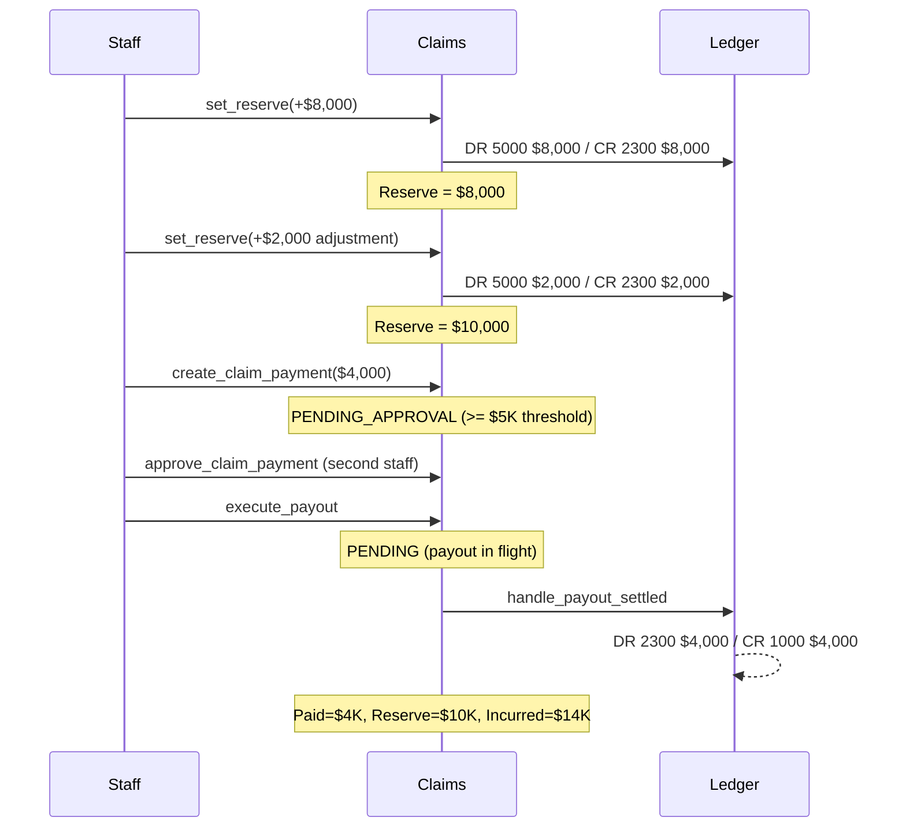

# Money Flows

## Double-Entry Ledger

Every financial transaction is recorded as a journal entry with balanced debit and credit lines. Posted entries are immutable — corrections use reversal + re-book.

### Invariants

- `sum(debits) == sum(credits)` for every posted journal entry
- Posted entries and lines are never updated or deleted
- All amounts in integer cents
- Idempotency keys prevent duplicate postings

## Chart of Accounts

| Code | Name | Type | Normal Balance |
|------|------|------|---------------|
| 1000 | Cash | Asset | Debit |
| 1010 | Stripe Clearing | Asset | Debit |
| 1100 | Premium Receivable | Asset | Debit |
| 2000 | Unearned Premium | Liability | Credit |
| 2100 | State Premium Tax Payable | Liability | Credit |
| 2150 | Stamping Fee Payable | Liability | Credit |
| 2200 | Broker Commission Payable | Liability | Credit |
| 2300 | Claim Reserve | Liability | Credit |
| 2400 | Refund Payable | Liability | Credit |
| 4000 | Earned Premium | Revenue | Credit |
| 4100 | Fee Revenue | Revenue | Credit |
| 4200 | Commission Clawback | Revenue | Credit |
| 5000 | Claims Expense | Expense | Debit |
| 5100 | Commission Expense | Expense | Debit |

## Key Financial Flows

### Policy Premium Collection (via Stripe Checkout)



Journal entry (TX: premium = $1,000, tax = $48.50, stamping fee = $0.40):
| Line | Account | Debit | Credit |
|------|---------|-------|--------|
| 1 | 1010 Stripe Clearing | 104,890 | |
| 2 | 2000 Unearned Premium | | 100,000 |
| 3 | 2100 State Premium Tax Payable | | 4,850 |
| 4 | 2150 Stamping Fee Payable | | 40 |

### Correction (Reversal + Re-book)

Original charge of $300 needs to be corrected to $350:

1. **Reversal entry** — mirrors the original with flipped debits/credits
2. **Re-book entry** — posts the correct $350 amount

All three entries remain permanently visible for audit.

### Claim Reserve Setting

When a reserve is set or increased:
| Line | Account | Debit | Credit |
|------|---------|-------|--------|
| 1 | 5000 Claims Expense | amount | |
| 2 | 2300 Claim Reserve | | amount |

When a reserve is released (negative amount):
| Line | Account | Debit | Credit |
|------|---------|-------|--------|
| 1 | 2300 Claim Reserve | amount | |
| 2 | 5000 Claims Expense | | amount |


**Reserve identity**: Incurred = Paid + Remaining Reserve

### Claim Payout Settled

When a payout is confirmed as settled:
| Line | Account | Debit | Credit |
|------|---------|-------|--------|
| 1 | 2300 Claim Reserve | amount | |
| 2 | 1000 Cash | | amount |


### Claim Payout Returned (Compensating Entry)

When a previously settled payout is returned:
| Line | Account | Debit | Credit |
|------|---------|-------|--------|
| 1 | 1000 Cash | amount | |
| 2 | 2300 Claim Reserve | | amount |


### Claim Financial Flow (Full Lifecycle)



### Broker Commission (posted at payment time)

Journal entry (15% on $1,000 premium = $150):
| Line | Account | Debit | Credit |
|------|---------|-------|--------|
| 1 | 5100 Commission Expense | 15,000 | |
| 2 | 2200 Broker Commission Payable | | 15,000 |


Commission is earned on collected premium only (not on tax/fees). Posted in the same transaction as the premium collection ledger entries. On cancellation, commission clawback reverses the commission.

## Tax and Fee Rules

Tax and fee rules are effective-dated per jurisdiction. Rule selection uses the policy's effective date, ensuring:

- Historical policies use the rules that were in effect at their inception
- A later rate change does not retroactively affect existing policies
- Tax/fees remain separate financial components from premium

### Texas Surplus-Lines Model (Implemented)

| Component | Rate | Ledger Account | Refundable |
|-----------|------|---------------|------------|
| TX Surplus Lines Premium Tax | 4.85% (485 bps) | 2100 State Premium Tax Payable | Yes |
| TX SLTX Stamping Fee | 0.04% (4 bps) | 2150 Stamping Fee Payable | Yes |

Sources: Texas Comptroller Rule 3.820, SLTX.

All rate calculations use `Decimal` arithmetic with `ROUND_HALF_UP` rounding. Rates stored as integer basis points. `calculate_rate_amount(amount_cents, rate_bps)` computes `(amount_cents × rate_bps) / 10000`.

## Endorsement Financial Flows

### Pro-Rata Calculation

Mid-term endorsements are priced from their effective date through the policy term end:

```
prorated_amount = (annual_delta × remaining_days) / total_days_in_term
```

- `remaining_days` = `policy.expiration_date − endorsement.effective_date`
- `total_days_in_term` = `policy.expiration_date − policy.effective_date` (366 for leap years)
- Calculation uses `Decimal` with `ROUND_HALF_UP`
- Tax and fee adjustments are similarly pro-rated using inception-date rates

### Endorsement Premium Increase

Journal entry (e.g., +$300 annual → $150 pro-rated, TX tax $7.28, stamping $0.01):
| Line | Account | Debit | Credit |
|------|---------|-------|--------|
| 1 | 1010 Stripe Clearing | 15,729 | |
| 2 | 2000 Unearned Premium | | 15,000 |
| 3 | 2100 State Premium Tax Payable | | 728 |
| 4 | 2150 Stamping Fee Payable | | 1 |

Commission on additional premium (15% on $150):
| Line | Account | Debit | Credit |
|------|---------|-------|--------|
| 1 | 5100 Commission Expense | 2,250 | |
| 2 | 2200 Broker Commission Payable | | 2,250 |

### Endorsement Correction (Reversal + Re-book)

When an endorsement is corrected (e.g., wrong effective date):

1. **Reversal entry**: Mirrors the original endorsement journal entry with flipped DR/CR
2. **Commission reversal**: Mirrors the original commission entry with flipped DR/CR
3. **Policy premium reverted**: `policy.premium_amount_cents -= original.annual_premium_delta_cents`
4. **Original marked REVERSED** (status only, no row mutation on journal entries)
5. **New endorsement created** with corrected effective date → pro-rated at new remaining days
6. **New endorsement applied** with new journal entries and commission

All original entries remain visible for audit. The correction is linked via `correction_of` foreign key.
