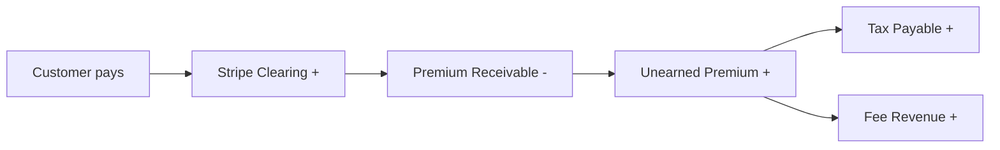

# Money Flows

## Double-Entry Ledger

Every financial transaction is recorded as a journal entry with balanced debit and credit lines. Posted entries are immutable — corrections use reversal + re-book.

### Invariants

- `sum(debits) == sum(credits)` for every posted journal entry
- Posted entries and lines are never updated or deleted
- All amounts in integer cents
- Idempotency keys prevent duplicate postings

## Chart of Accounts

| Code | Name | Type | Normal Balance |
|------|------|------|---------------|
| 1000 | Cash | Asset | Debit |
| 1010 | Stripe Clearing | Asset | Debit |
| 1100 | Premium Receivable | Asset | Debit |
| 2000 | Unearned Premium | Liability | Credit |
| 2100 | State Premium Tax Payable | Liability | Credit |
| 2150 | Stamping Fee Payable | Liability | Credit |
| 2200 | Broker Commission Payable | Liability | Credit |
| 2300 | Claim Reserve | Liability | Credit |
| 2400 | Refund Payable | Liability | Credit |
| 4000 | Earned Premium | Revenue | Credit |
| 4100 | Fee Revenue | Revenue | Credit |
| 4200 | Commission Clawback | Revenue | Credit |
| 5000 | Claims Expense | Expense | Debit |
| 5100 | Commission Expense | Expense | Debit |

## Key Financial Flows

### Policy Premium Collection

Journal entry (TX: premium = $1,000, tax = $48.50, stamping fee = $0.40):
| Line | Account | Debit | Credit |
|------|---------|-------|--------|
| 1 | 1010 Stripe Clearing | 104,890 | |
| 2 | 2000 Unearned Premium | | 100,000 |
| 3 | 2100 State Premium Tax Payable | | 4,850 |
| 4 | 2150 Stamping Fee Payable | | 40 |

### Correction (Reversal + Re-book)

Original charge of $300 needs to be corrected to $350:

1. **Reversal entry** — mirrors the original with flipped debits/credits
2. **Re-book entry** — posts the correct $350 amount

All three entries remain permanently visible for audit.

### Claim Reserve and Payment

### Commission

On cancellation, commission clawback reverses the commission.

## Tax and Fee Rules

Tax and fee rules are effective-dated per jurisdiction. Rule selection uses the policy's effective date, ensuring:

- Historical policies use the rules that were in effect at their inception
- A later rate change does not retroactively affect existing policies
- Tax/fees remain separate financial components from premium

### Texas Surplus-Lines Model (Implemented)

| Component | Rate | Ledger Account | Refundable |
|-----------|------|---------------|------------|
| TX Surplus Lines Premium Tax | 4.85% (485 bps) | 2100 State Premium Tax Payable | Yes |
| TX SLTX Stamping Fee | 0.04% (4 bps) | 2150 Stamping Fee Payable | Yes |

Sources: Texas Comptroller Rule 3.820, SLTX.

All rate calculations use `Decimal` arithmetic with `ROUND_HALF_UP` rounding. Rates stored as integer basis points. `calculate_rate_amount(amount_cents, rate_bps)` computes `(amount_cents × rate_bps) / 10000`.
