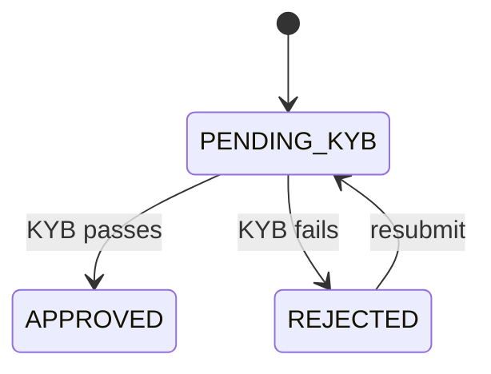
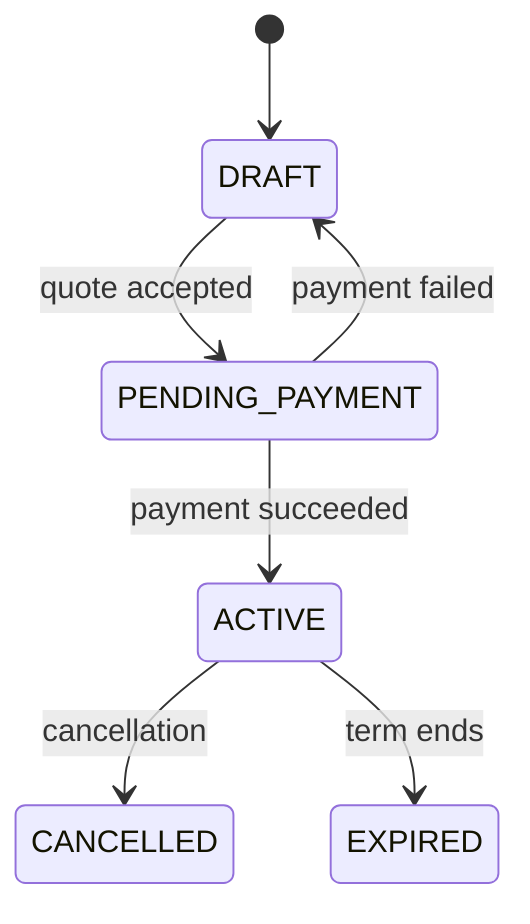
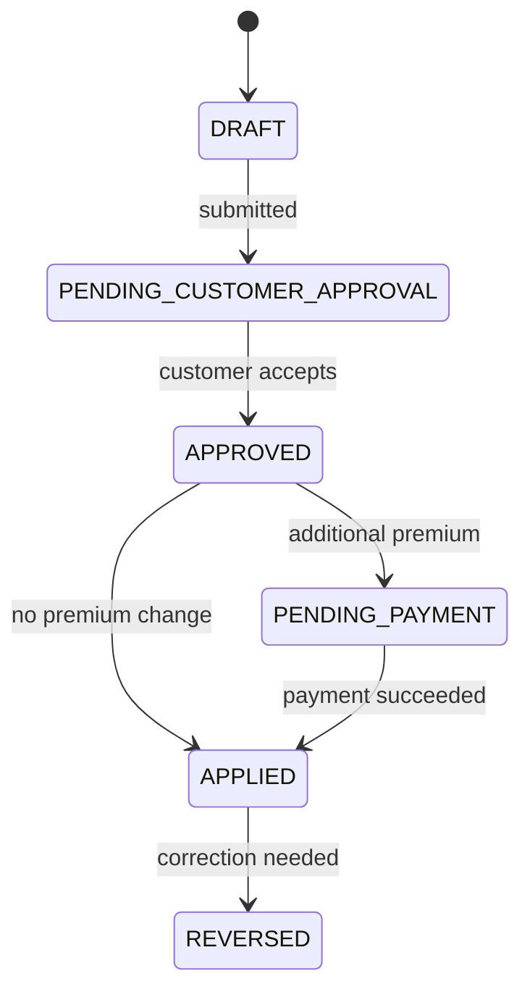
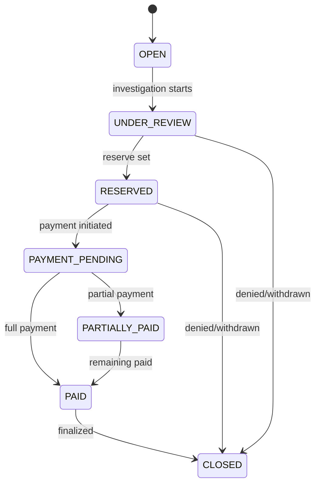
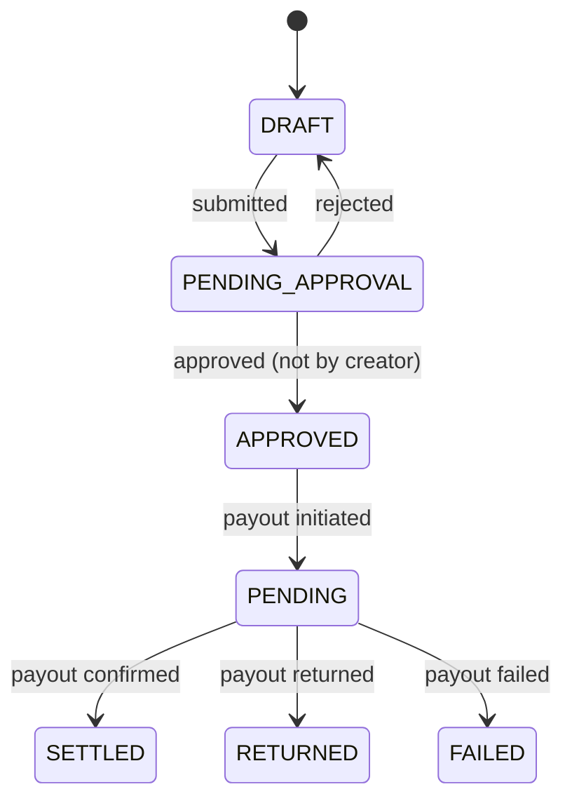
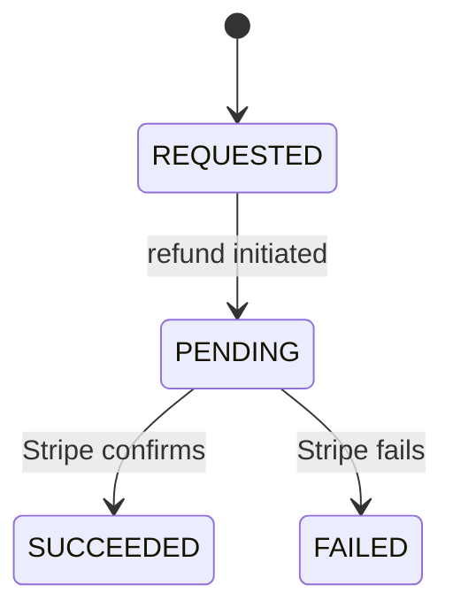
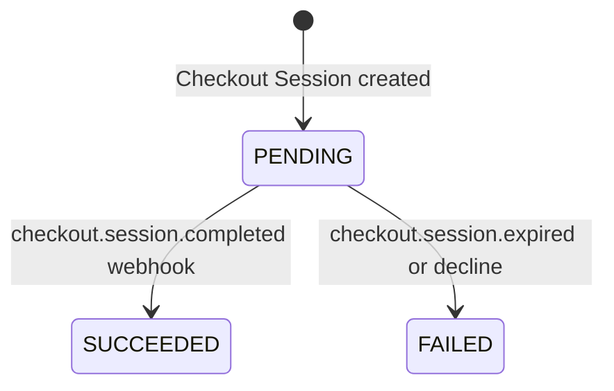
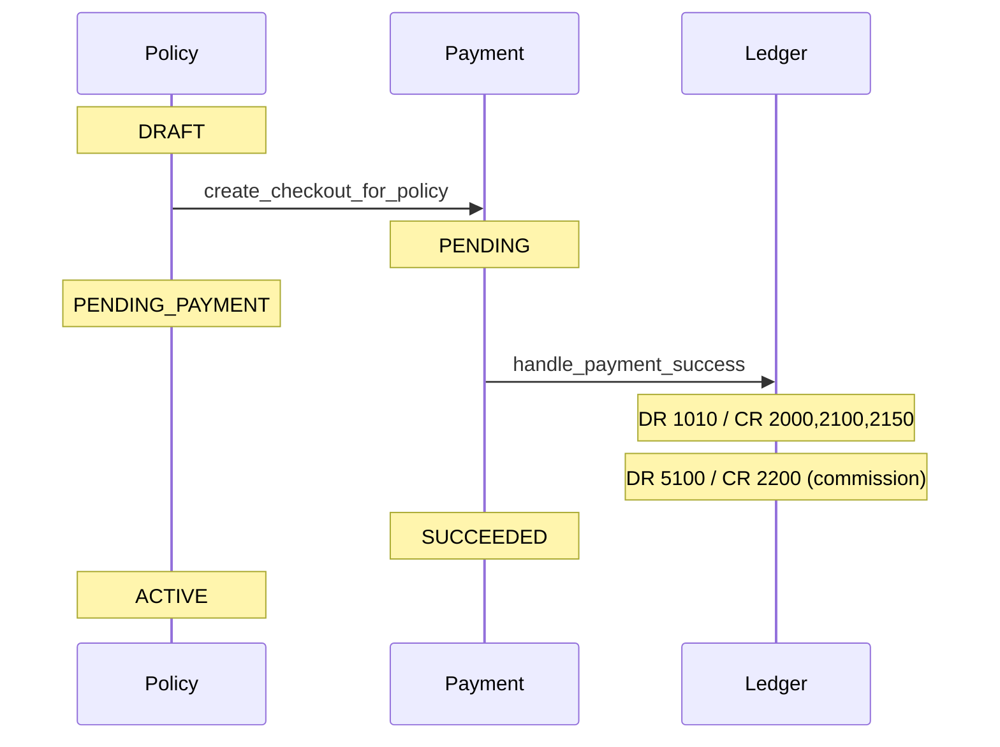

# State Machines

## Broker Status

A broker must be APPROVED before binding new business (writing policies).

## Policy Status

Policy status represents the lifecycle of the policy itself. Payment and refund states are tracked separately on their own models.

## Endorsement Status

## Claim Status

## Claim Payment Status

The maker-checker rule applies: the person who creates a claim payment cannot approve it.

## Refund Status

## Payment Status

Payment uses Stripe Checkout Sessions (redirect flow). The PENDING state represents a Checkout Session that the customer has been redirected to. Success is confirmed via the `checkout.session.completed` webhook, which triggers ledger posting and policy activation.

### Payment + Policy Interaction

